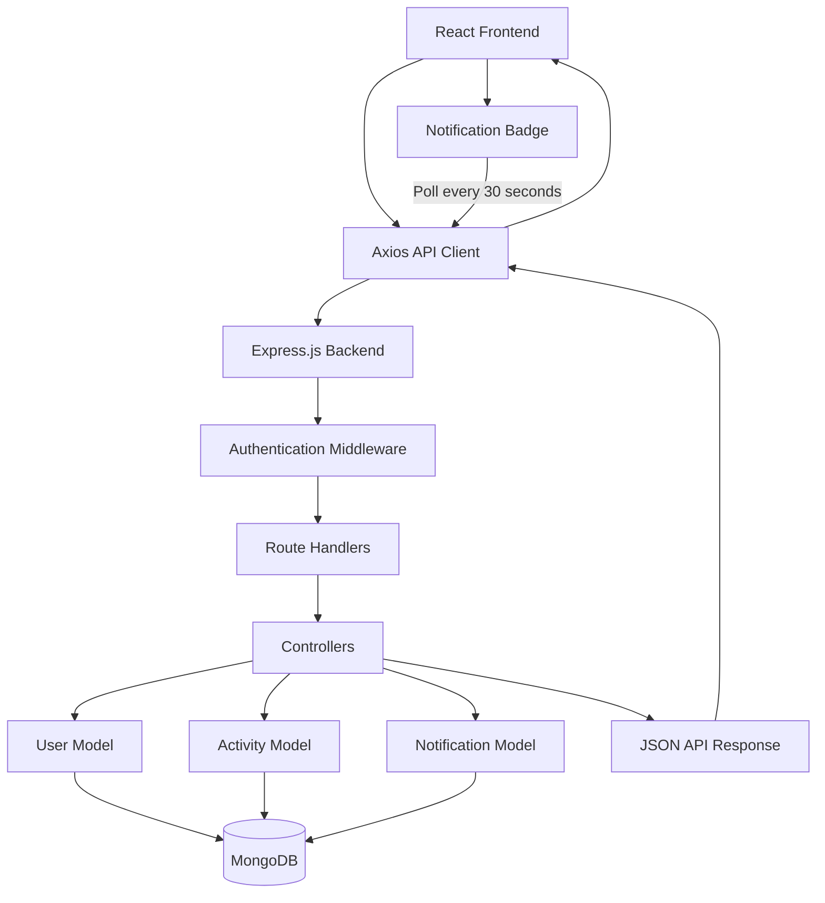
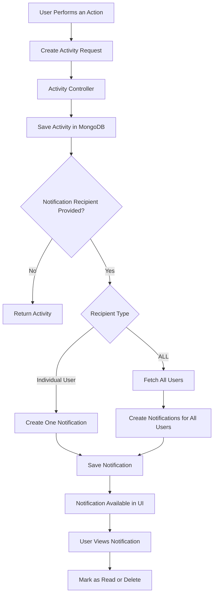

# Activity & Notification System

A full-stack MERN application that provides centralized activity tracking and notification management. It allows users to record activities, monitor changes, receive notifications, and track unread notification counts through a simple web interface.

## Features

### 1. User Authentication
- User registration and login.
- JWT-based authentication.
- Protected API routes.
- Password hashing using bcrypt.
- Persistent login state.
- Profile and password management.

### 2. Activity Management
- Create and maintain activity records.
- Track different action types:
  - `CREATED`
  - `UPDATED`
  - `STATUS_CHANGED`
  - `LOGIN`
  - `ASSIGNED`
- Associate activities with different entity types using `entityType` and `entityId`.
- Store additional structured information using metadata.
- Edit and delete activities.
- View activity history with pagination.

### 3. Notification Management
- Create notifications for individual users.
- Send notifications to all registered users.
- Link notifications to corresponding activity records.
- View notifications with read/unread status.
- Mark individual notifications as read.
- Mark all notifications as read.
- Delete notifications.
- Filter notifications by read status.

### 4. Unread Notification Counter
- Dedicated unread-count API.
- Display unread notification count in the navigation bar.
- Automatically refresh the count every **30 seconds** using frontend polling.
- Display `99+` when the unread count exceeds 99.
- Hide the notification badge when there are no unread notifications.

### 5. Activity Filtering and Search
- Filter activities by action type.
- Filter by entity type.
- Search activity descriptions.
- Filter activities by date range.
- Pagination for activity records.

---

## Technology Stack

| Layer | Technologies |
|---|---|
| Frontend | React.js, Vite |
| Routing | React Router |
| API Communication | Axios |
| Backend | Node.js, Express.js |
| Database | MongoDB |
| ODM | Mongoose |
| Authentication | JSON Web Tokens (JWT) |
| Password Security | bcryptjs |
| Styling | CSS |
| Development | Nodemon, Concurrently |

---

## System Architecture

The application follows a frontend-backend architecture.



### Application Flow

1. Users register or log in through the React frontend.
2. The backend validates credentials and generates a JWT.
3. The frontend attaches the JWT to API requests using an Axios request interceptor.
4. Authentication middleware validates protected requests.
5. Controllers perform application operations using Mongoose models.
6. MongoDB stores user, activity, and notification records.
7. The frontend displays the returned data.
8. The notification badge periodically requests the unread notification count.

---

## Project Structure

```text
Activity-Notification-System/
│
├── backend/
│   ├── controllers/
│   │   ├── activityController.js
│   │   ├── authController.js
│   │   ├── notificationController.js
│   │   ├── settingsController.js
│   │   └── userController.js
│   │
│   ├── middleware/
│   │   └── authMiddleware.js
│   │
│   ├── models/
│   │   ├── Activity.js
│   │   ├── Notification.js
│   │   └── User.js
│   │
│   ├── routes/
│   │   ├── activityRoutes.js
│   │   ├── authRoutes.js
│   │   ├── notificationRoutes.js
│   │   ├── settingsRoutes.js
│   │   └── userRoutes.js
│   │
│   ├── server.js
│   └── package.json
│
├── frontend/
│   ├── src/
│   │   ├── api/
│   │   │   └── index.js
│   │   │
│   │   ├── components/
│   │   │   ├── ActivityLog/
│   │   │   ├── Auth/
│   │   │   ├── Notifications/
│   │   │   ├── Settings/
│   │   │   └── Users/
│   │   │
│   │   ├── context/
│   │   │   └── AuthContext.jsx
│   │   │
│   │   ├── App.jsx
│   │   ├── App.css
│   │   └── main.jsx
│   │
│   ├── index.html
│   ├── vite.config.js
│   └── package.json
│
├── package.json
├── package-lock.json
└── README.md
```

---

## Database Design

The application uses three main MongoDB models.

### 1. User Model

Stores registered user information.

| Field | Description |
|---|---|
| `_id` | Unique user identifier |
| `name` | User's name |
| `email` | Unique email address |
| `password` | Hashed password |
| `createdAt` | Account creation timestamp |
| `updatedAt` | Last update timestamp |

**Implementation details:**
- Passwords are hashed using bcrypt before saving.
- Password fields are excluded from query results by default.
- Email addresses are unique and stored in lowercase.
- Password comparison is handled through a model instance method.

### 2. Activity Model

Stores actions performed by users.

| Field | Description |
|---|---|
| `_id` | Unique activity identifier |
| `actorId` | Reference to the user who performed the action |
| `actionType` | Type of activity |
| `entityType` | Name of the associated entity type |
| `entityId` | Identifier of the associated entity |
| `description` | Human-readable activity description |
| `metadata` | Additional structured information |
| `createdAt` | Activity creation timestamp |
| `updatedAt` | Last update timestamp |

**Important implementation details:**

- `actorId` references the User model.
- `entityType` is a flexible string rather than a fixed enum.
- `entityId` stores the associated MongoDB ObjectId.
- `metadata` uses Mongoose's `Mixed` type to support additional structured data.
- Compound and timestamp indexes support common filtering and sorting operations.

Example activity document:

```json
{
  "actorId": "USER_OBJECT_ID",
  "actionType": "STATUS_CHANGED",
  "entityType": "Lead",
  "entityId": "ENTITY_OBJECT_ID",
  "description": "Lead status changed from New to Won",
  "metadata": {
    "from": "New",
    "to": "Won"
  }
}
```

### 3. Notification Model

Stores notifications associated with individual recipients.

| Field | Description |
|---|---|
| `_id` | Unique notification identifier |
| `recipientId` | Reference to the recipient User |
| `activityId` | Optional reference to an Activity |
| `title` | Notification title |
| `message` | Notification description |
| `isRead` | Read/unread status |
| `createdAt` | Notification creation timestamp |
| `updatedAt` | Last update timestamp |

**Important implementation details:**

- Each notification belongs to a recipient.
- Notifications can optionally reference an activity.
- `isRead` defaults to `false`.
- Activity details and actor information can be populated using Mongoose.

---

## Activity and Notification Workflow

The activity and notification modules are connected.



### How it works

1. A user creates an activity by providing the action type, entity type, description, and optional metadata.
2. The backend saves the activity.
3. The request can optionally include `notifyUserId`.
4. If an individual recipient is provided, a notification is created for that user.
5. If `notifyUserId` is `ALL`, the backend retrieves all users and creates a notification for each.
6. The notification is linked to the activity through `activityId`.
7. Users can view the notification and access its associated activity details.

---

## Notification Polling Mechanism

The application uses polling to periodically refresh the unread notification count.

**Implementation:** `frontend/src/components/Notifications/NotificationBadge.jsx`

```
